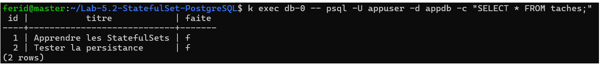
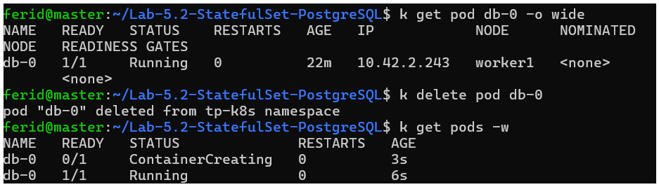
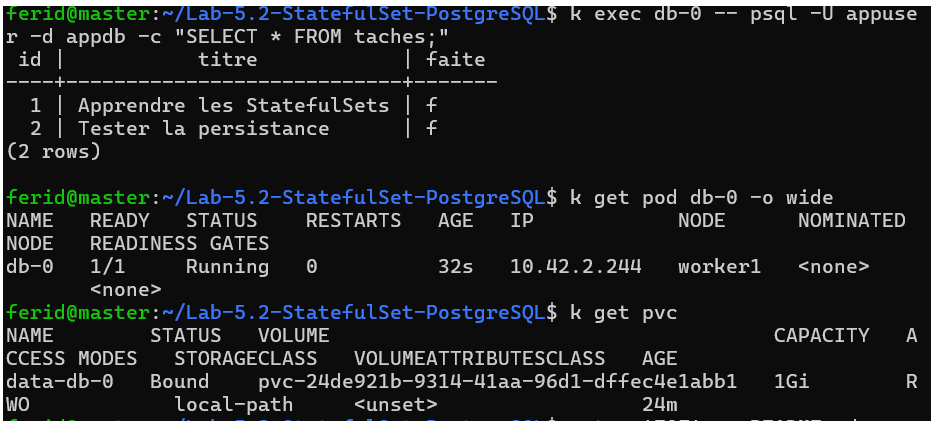
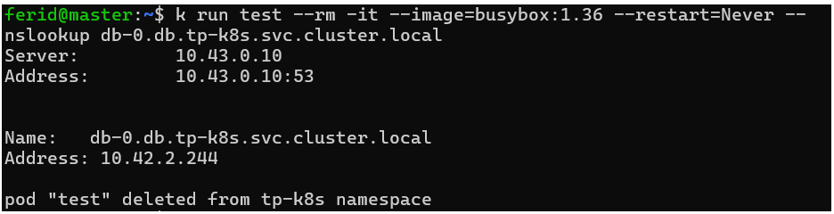
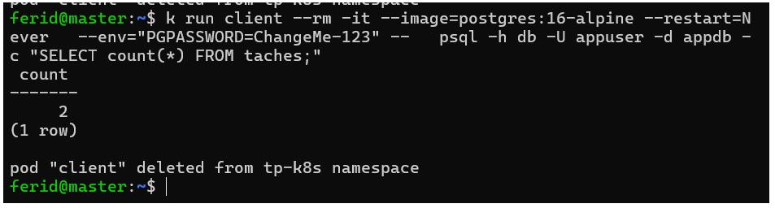
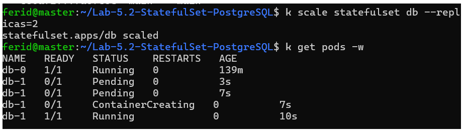
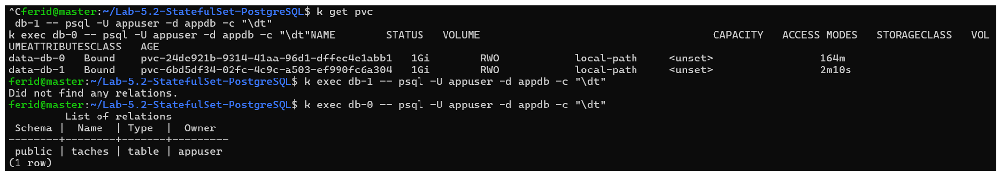
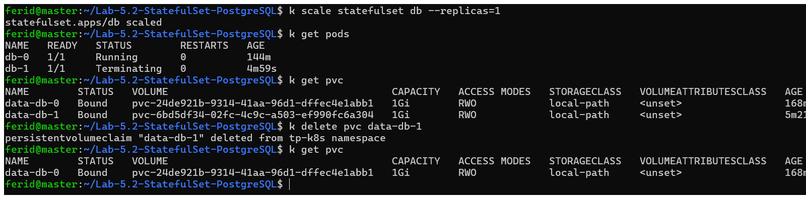
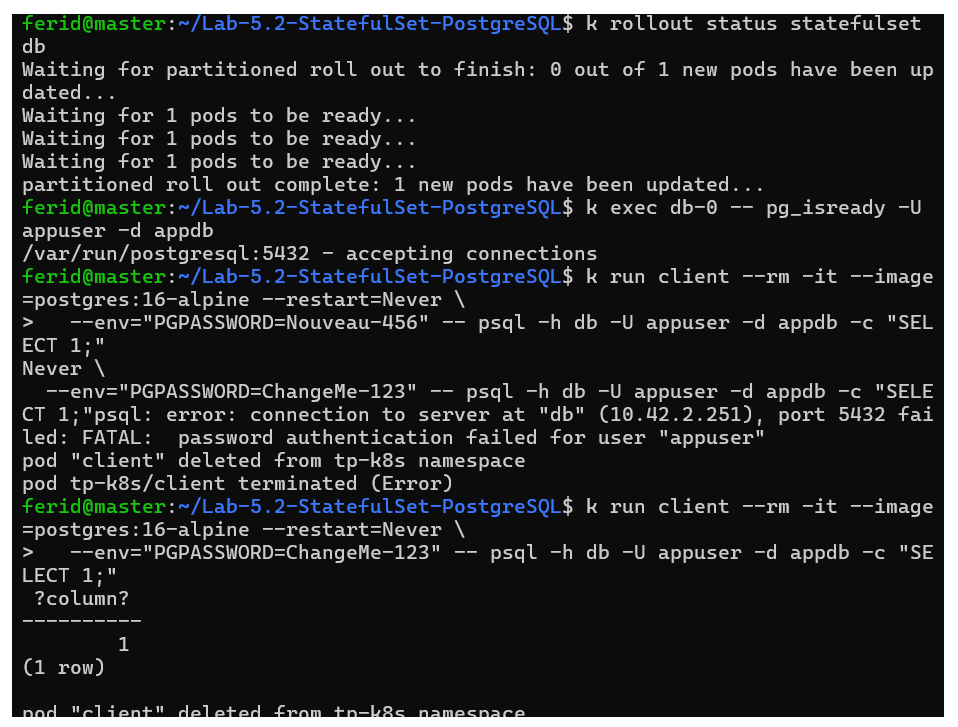
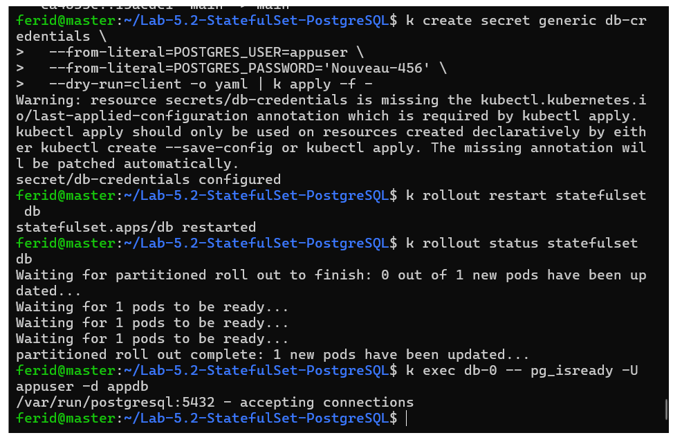

# Lab 5.2 : Base de données avec StatefulSet

**Auteur :** Ferid Saad
**Cours :** Kubernetes avec k3s, ISET Tozeur (Master DevOps & Cloud)
**Cluster :** k3s-vbox (master, worker1, worker2)
**Namespace :** tp-k8s

## Objectifs

- Déployer PostgreSQL avec un StatefulSet, un Service headless et un volume par Pod
- Injecter la configuration avec un ConfigMap et un Secret
- Démontrer que les données survivent à la suppression du Pod
- Observer les noms DNS d'un Service headless
- Constater que deux réplicas d'un StatefulSet ne partagent pas leurs données

## Architecture

ConfigMap `app-config` + Secret `db-credentials` -> StatefulSet `db` (Pod `db-0`, PostgreSQL 16) -> PVC `data-db-0` (local-path), exposé par le Service headless `db`.

## Étape 1 : Préparer la configuration

Création du namespace `tp-k8s`, du ConfigMap `app-config` (DB_HOST, DB_PORT, DB_NAME) et du Secret `db-credentials` (POSTGRES_USER, POSTGRES_PASSWORD).

```bash
k create namespace tp-k8s
k config set-context --current --namespace=tp-k8s
k apply -f app-config.yaml
k create secret generic db-credentials \
  --from-literal=POSTGRES_USER=appuser \
  --from-literal=POSTGRES_PASSWORD='ChangeMe-123'
k get configmap,secret
```

**Point de contrôle :**
- [x] Le ConfigMap `app-config` et le Secret `db-credentials` existent


## Étape 2 : Déployer la base avec un StatefulSet

Création d'un Service headless `db` (`clusterIP: None`) et d'un StatefulSet `db` (1 réplica, `postgres:16-alpine`). La configuration vient du Secret et du ConfigMap, et un PVC `data-db-0` (local-path, 1Gi) est créé via `volumeClaimTemplates`. `PGDATA` pointe vers un sous-dossier du volume pour éviter les conflits avec la racine du point de montage.

```bash
k apply -f db.yaml
k get statefulset,service,pvc,pv
k logs db-0 | tail -n 5
k exec db-0 -- pg_isready -U appuser -d appdb
```

**Points de contrôle :**
- [x] Le Pod s'appelle `db-0`
- [x] Le PVC `data-db-0` est `Bound` à un PV
- [x] `pg_isready` répond `accepting connections`
- [x] Les logs indiquent que le système est prêt à accepter des connexions


### Incident rencontré : Pod `db-0` bloqué en `Pending`

**Symptôme :** `db-0` restait en `Pending` pendant plus de 30 minutes.

**Diagnostic :** `k describe pod db-0` affichait `FailedScheduling` avec `didn't match PersistentVolume's node affinity` et `untolerated taint(s)`. `k describe nodes` montrait le taint `node.kubernetes.io/disk-pressure:NoSchedule` sur `worker1` et `worker2`. Le PV local-path de `db-0` étant lié à `worker2`, le Pod ne pouvait être planifié nulle part.

**Cause :** disque des workers presque plein (12 Go, environ 80 % utilisés), ce qui déclenchait la condition `DiskPressure`.

**Résolution :** extension du volume logique des workers (disque passé à 23 Go, environ 40 % utilisés). Le taint a été levé après le délai de transition du kubelet et `db-0` est passé en `Running`.

```bash
k describe pod db-0 | tail -n 20
k describe nodes | grep -E "^Name:|Taints:"
k get pv <nom-du-pv> -o jsonpath='{.spec.nodeAffinity}'
df -h /
```

**À retenir :** avec `local-path`, un volume est lié à un seul nœud : si ce nœud est indisponible ou sous pression disque, le Pod reste `Pending`.


### Second problème : initialisation interrompue

**Symptôme :** une fois `db-0` en `Running`, les logs répétaient chaque minute `FATAL: "base/1" is not a valid data directory` et `File "base/1/PG_VERSION" is missing`, alors que `pg_isready` répondait.

**Cause :** le premier démarrage de PostgreSQL avait été interrompu en pleine initialisation (Pod évincé sous la pression disque), laissant un volume partiellement initialisé.

**Résolution :** suppression du StatefulSet et du PVC `data-db-0` (aucune donnée à ce stade), puis `k apply -f db.yaml` pour repartir d'un volume vide. Les logs indiquent ensuite `PostgreSQL init process complete` et plus aucune erreur `FATAL`.

```bash
k delete statefulset db
k delete pvc data-db-0
k apply -f db.yaml
```

**À retenir :** un volume dont l'initialisation a été interrompue doit être recréé, car PostgreSQL ne répare pas un `initdb` incomplet.

## Étape 3 : Créer des données

Création de la table `taches` dans la base `appdb` et insertion de deux lignes.

```bash
k exec db-0 -- psql -U appuser -d appdb -c "CREATE TABLE taches (id serial PRIMARY KEY, titre text NOT NULL, faite boolean DEFAULT false);"
k exec db-0 -- psql -U appuser -d appdb -c "INSERT INTO taches (titre) VALUES ('Apprendre les StatefulSets'), ('Tester la persistance');"
k exec db-0 -- psql -U appuser -d appdb -c "SELECT * FROM taches;"
```

**Point de contrôle :**
- [x] La requête `SELECT` renvoie deux lignes



## Étape 4 : Prouver la persistance

Suppression du Pod `db-0` pour vérifier que le StatefulSet le recrée avec la même identité (même nom, même PVC) et que les données sont conservées.

```bash
k get pod db-0 -o wide
k delete pod db-0
k get pods -w
k exec db-0 -- pg_isready -U appuser -d appdb
k exec db-0 -- psql -U appuser -d appdb -c "SELECT * FROM taches;"
k get pod db-0 -o wide
k get pvc
```

**Constat :** le Pod recréé s'appelle toujours `db-0`, s'exécute sur le même nœud et se rattache au même PVC `data-db-0`. Les deux lignes de la table `taches` sont toujours présentes.


**Points de contrôle :**
- [x] Le Pod recréé porte le même nom `db-0`
- [x] Les deux lignes sont toujours présentes
- [x] Le Pod s'exécute sur le même nœud, avec le même PVC `data-db-0`

## Étape 5 : Joindre la base par son nom DNS

Interrogation du DNS depuis un Pod temporaire, puis connexion avec un client PostgreSQL via le nom du Service headless `db`. L'IP de `db-0` ayant changé après sa recréation (`10.42.2.243` puis `10.42.2.244`), c'est le nom DNS qui garantit la joignabilité.

```bash
k run test --rm -it --image=busybox:1.36 --restart=Never -- nslookup db
k run test --rm -it --image=busybox:1.36 --restart=Never -- nslookup db-0.db.tp-k8s.svc.cluster.local
k run client --rm -it --image=postgres:16-alpine --restart=Never \
  --env="PGPASSWORD=ChangeMe-123" -- \
  psql -h db -U appuser -d appdb -c "SELECT count(*) FROM taches;"
```

**Constat :**
- `nslookup db` renvoie directement l'IP du Pod `db-0` (`10.42.2.244`), sans adresse de Service virtuelle : c'est la particularité d'un Service headless.
- Chaque Pod a un nom DNS stable : `db-0.db.tp-k8s.svc.cluster.local` renvoie la même IP.
- Les lignes `NXDOMAIN` affichées par `nslookup` sont les essais successifs des domaines de recherche du Pod, sans gravité.

**Remarque sur `busybox` :** avec `busybox:1.36`, `nslookup db-0.db` (nom court) échoue en `NXDOMAIN`, alors que le nom complet fonctionne. Ce comportement vient de `nslookup` et pas du cluster.

**Remarque sécurité :** passer un mot de passe en variable d'environnement sur la ligne de commande est acceptable pour un TP, mais à éviter ailleurs : il reste visible dans l'historique et dans la définition du Pod.

**Points de contrôle :**
- [x] `nslookup db` renvoie l'adresse IP du Pod `db-0`


- [x] Le client se connecte avec le nom `db` et obtient `2`



## Étape 6 : Passer à deux réplicas

Passage du StatefulSet à 2 réplicas pour observer la création ordonnée des Pods et l'indépendance des volumes, puis retour à 1 réplica.

```bash
k scale statefulset db --replicas=2
k get pods -w
k get pvc
k exec db-1 -- psql -U appuser -d appdb -c "\dt"
k exec db-0 -- psql -U appuser -d appdb -c "\dt"
k scale statefulset db --replicas=1
k get pods
k get pvc
k delete pvc data-db-1
k get pvc
```





**Constat :**
- `db-1` n'a démarré qu'après que `db-0` était prêt (création ordonnée).
- `db-1` a son propre PVC `data-db-1` et sa base est vide : un StatefulSet ne réplique pas les données. La réplication doit être configurée dans la base elle-même.
- Après la réduction à un réplica, `data-db-1` existait toujours : Kubernetes ne supprime pas automatiquement les PVC d'un StatefulSet, pour éviter de détruire des données par erreur. Il a fallu le supprimer manuellement.

**Points de contrôle :**
- [x] `db-1` a été créé après `db-0` et avec un PVC distinct
- [x] La table `taches` n'existait pas dans `db-1`
- [x] Après la réduction à un réplica, `data-db-1` subsistait jusqu'à sa suppression manuelle



## Étape 7 : Comprendre le rôle du mot de passe initial

Modification du mot de passe dans le Secret `db-credentials`, redémarrage du StatefulSet, puis test des deux mots de passe depuis un client.

```bash
k create secret generic db-credentials \
  --from-literal=POSTGRES_USER=appuser \
  --from-literal=POSTGRES_PASSWORD='Nouveau-456' \
  --dry-run=client -o yaml | k apply -f -
k rollout restart statefulset db
k rollout status statefulset db
k exec db-0 -- pg_isready -U appuser -d appdb
k run client --rm -it --image=postgres:16-alpine --restart=Never \
  --env="PGPASSWORD=Nouveau-456" -- psql -h db -U appuser -d appdb -c "SELECT 1;"
k run client --rm -it --image=postgres:16-alpine --restart=Never \
  --env="PGPASSWORD=ChangeMe-123" -- psql -h db -U appuser -d appdb -c "SELECT 1;"
```

**Constat :** le nouveau mot de passe est refusé et l'ancien fonctionne encore. PostgreSQL ne lit `POSTGRES_PASSWORD` qu'à la première initialisation d'un volume vide : ensuite, le mot de passe est enregistré dans la base elle-même. Modifier le Secret ne suffit donc pas ; il faut changer le mot de passe avec une commande SQL (`ALTER USER appuser PASSWORD '...'`).

**Points de contrôle :**
- [x] Le Pod `db-0` a redémarré avec les données intactes
- [x] Le nouveau mot de passe est refusé, l'ancien est accepté
- [x] Je peux expliquer pourquoi modifier le Secret ne suffit pas





## Questions de réflexion

**1. Pourquoi le Pod recréé s'appelle-t-il encore `db-0` et retrouve-t-il ses données ?**
Un StatefulSet donne à ses Pods une identité stable : un nom ordonné et un volume associé. Quand `db-0` est supprimé, un Pod de même nom est recréé et rattaché au même PVC `data-db-0`, donc aux mêmes données.

**2. Quelle est la particularité d'un Service headless et pourquoi le préfère-t-on pour un StatefulSet ?**
Il n'a pas d'adresse virtuelle (`clusterIP: None`) : le DNS renvoie directement les adresses des Pods, et chaque Pod a un nom DNS stable (`db-0.db`). C'est utile quand on doit distinguer les membres d'un groupe, par exemple une base répliquée, et que l'IP d'un Pod change à chaque recréation.

**3. Pourquoi la table `taches` n'existait-elle pas dans `db-1` ?**
Un StatefulSet ne réplique pas les données : chaque Pod a son propre volume et sa propre base. La réplication doit être configurée dans la base elle-même.

**4. Pourquoi le PVC `data-db-1` a-t-il subsisté après la réduction à un réplica ?**
Kubernetes ne supprime pas automatiquement les PVC d'un StatefulSet, pour éviter de détruire des données par erreur. Il faut les supprimer explicitement.

**5. Pourquoi le changement du mot de passe dans le Secret n'a-t-il pas modifié celui de la base ?**
`POSTGRES_PASSWORD` n'est utilisée qu'à la création de la base, sur un volume vide. Une fois la base initialisée, le mot de passe est conservé dans ses données ; il faut le modifier avec une commande SQL (`ALTER USER`).

## Conclusion

Ce lab a montré qu'un StatefulSet associe à chaque Pod une identité stable (nom, volume, nom DNS), ce qui permet à PostgreSQL de conserver ses données malgré la recréation du Pod. Il a aussi mis en évidence trois limites : pas de réplication automatique des données, PVC conservés après une réduction d'échelle, et mot de passe initial non relu après l'initialisation. Deux incidents liés à la pression disque des workers ont été diagnostiqués et corrigés (voir étape 2).

## Nettoyage

```bash
k delete namespace tp-k8s
k config set-context --current --namespace=default
k get pv
```

La suppression du namespace supprime aussi les PVC, et les PV local-path disparaissent avec eux. Aucun volume de ce lab ne subsiste dans `k get pv`.
