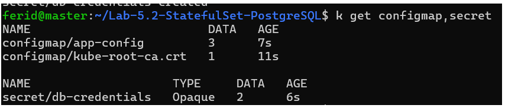
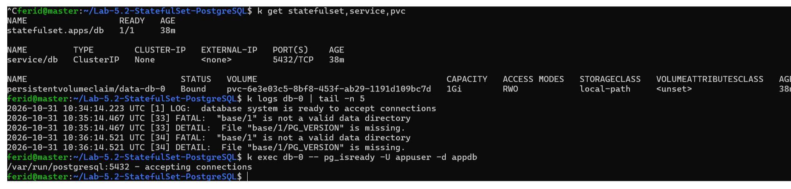

# Lab 5.2 : Base de données avec StatefulSet

**Auteur :** Ferid Saad
**Cours :** Kubernetes avec k3s, ISET Tozeur (Master DevOps & Cloud)
**Cluster :** k3s-vbox (master, worker1, worker2)
**Namespace :** tp-k8s

## Objectifs

- Déployer PostgreSQL avec un StatefulSet, un Service headless et un volume par Pod
- Injecter la configuration avec un ConfigMap et un Secret
- Démontrer que les données survivent à la suppression du Pod
- Observer les noms DNS d'un Service headless
- Constater que deux réplicas d'un StatefulSet ne partagent pas leurs données

## Architecture

ConfigMap `app-config` + Secret `db-credentials` -> StatefulSet `db` (Pod `db-0`, PostgreSQL 16) -> PVC `data-db-0` (local-path), exposé par le Service headless `db`.

## Étape 1 : Préparer la configuration

Création du namespace `tp-k8s`, du ConfigMap `app-config` (DB_HOST, DB_PORT, DB_NAME) et du Secret `db-credentials` (POSTGRES_USER, POSTGRES_PASSWORD).

```bash
k create namespace tp-k8s
k config set-context --current --namespace=tp-k8s
k apply -f app-config.yaml
k create secret generic db-credentials \
  --from-literal=POSTGRES_USER=appuser \
  --from-literal=POSTGRES_PASSWORD='ChangeMe-123'
k get configmap,secret
```

**Point de contrôle :**
- [x] Le ConfigMap `app-config` et le Secret `db-credentials` existent



## Étape 2 : Déployer la base avec un StatefulSet

Création d'un Service headless `db` (`clusterIP: None`) et d'un StatefulSet `db` (1 réplica, `postgres:16-alpine`). La configuration vient du Secret et du ConfigMap, et un PVC `data-db-0` (local-path, 1Gi) est créé via `volumeClaimTemplates`. `PGDATA` pointe vers un sous-dossier du volume pour éviter les conflits avec la racine du point de montage.

```bash
k apply -f db.yaml
k get statefulset,service,pvc,pv
k logs db-0 | tail -n 5
k exec db-0 -- pg_isready -U appuser -d appdb
```

**Points de contrôle :**
- [x] Le Pod s'appelle `db-0`
- [x] Le PVC `data-db-0` est `Bound` à un PV
- [x] `pg_isready` répond `accepting connections`
- [x] Les logs indiquent que le système est prêt à accepter des connexions



### Incident rencontré : Pod `db-0` bloqué en `Pending`

**Symptôme :** `db-0` restait en `Pending` pendant plus de 30 minutes.

**Diagnostic :** `k describe pod db-0` affichait `FailedScheduling` avec `didn't match PersistentVolume's node affinity` et `untolerated taint(s)`. `k describe nodes` montrait le taint `node.kubernetes.io/disk-pressure:NoSchedule` sur `worker1` et `worker2`. Le PV local-path de `db-0` étant lié à `worker2`, le Pod ne pouvait être planifié nulle part.

**Cause :** disque des workers presque plein (12 Go, environ 80 % utilisés), ce qui déclenchait la condition `DiskPressure`.

**Résolution :** extension du volume logique des workers (disque passé à 23 Go, environ 40 % utilisés). Le taint a été levé après le délai de transition du kubelet et `db-0` est passé en `Running`.

```bash
k describe pod db-0 | tail -n 20
k describe nodes | grep -E "^Name:|Taints:"
k get pv <nom-du-pv> -o jsonpath='{.spec.nodeAffinity}'
df -h /
```

**À retenir :** avec `local-path`, un volume est lié à un seul nœud : si ce nœud est indisponible ou sous pression disque, le Pod reste `Pending`.

